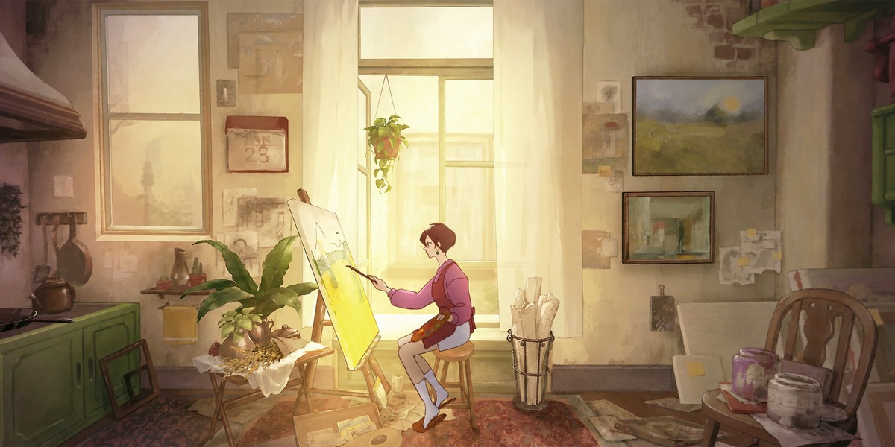
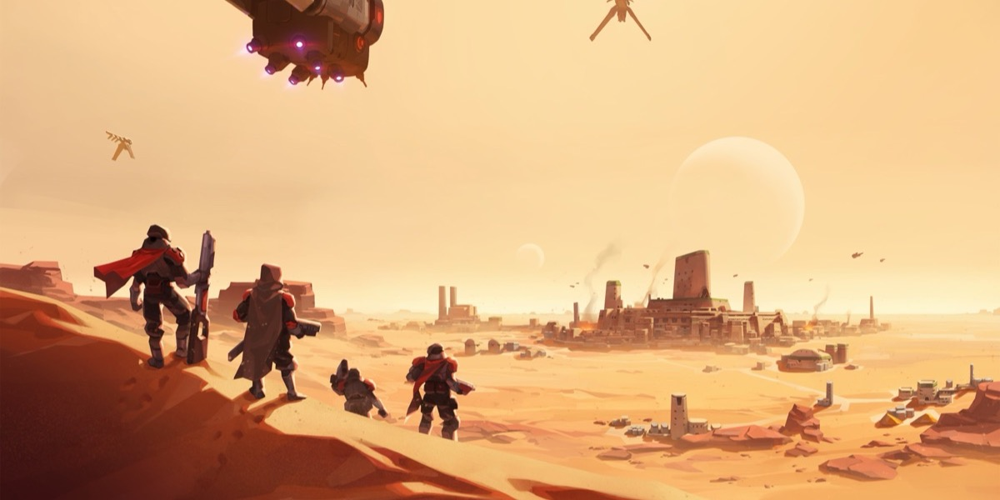

# Oleksandr Novikov

Backend Engineer & AI Integration Developer · Brno, Czech Republic

I build backend services in Java — mostly Quarkus and Spring — and, lately, the parts
of them that talk to LLMs. Outside of work I translate games into Ukrainian and keep
the tooling of a Ukrainian fan-dubbing team running.

## Work

**Now — Backend Engineer & AI Integration Developer** · AI / PropTech · since July 2026\
Project details are under NDA. Backend development, integrations with external systems
through authenticated API clients, and production LLM features together with the
reliability work that keeps them up on live services.

**Before — Backend Engineer** · PropTech / fintech · 2024–2026
- Services connecting real-estate products to ČSOB's core banking systems.
- Built an import of a public business registry from scratch: about 7 million records.
- Replaced a legacy sync with real-time integrations driven by NATS events.
- Worked on migrating services from Node.js to Quarkus.
- Brought critical legacy modules to ~90% test coverage with Testcontainers.

On the side: multi-model AI pipelines — image processing, and matching documents
across incompatible formats with web-search enrichment.

## Vocal Games

Since January 2026 I'm in the core team of [Vocal Games](https://t.me/VocalGames),
a Ukrainian fan-dubbing team — and its only engineer.
- VGbot, the Telegram bot the whole task pipeline runs through.
- Admin tooling instead of spreadsheets: casting, release readiness, reminders.
- A glossary that fills itself from the EN/UA lines in project sheets.
- OAuth2, error reports, systemd and CI/CD on a VPS.

## Ukrainian translations

A hobby: made games playable in Ukrainian — the text, fonts that gained Ї, Є
and Ґ, and in-game art redrawn where the text is part of the picture.

<!-- ukrainify:start -->
<table>
<tr>
<td width="50%" valign="top">

**[Behind the Frame: The Finest Scenery](https://github.com/Iskamele/Ukrainify-Behind-the-Frame-The-Finest-Scenery)** 
Переклад 100% · версія 1.1 
703 репліки · 85 зображень
</td>
<td width="50%" valign="top">

**[Dune: Spice Wars](https://github.com/Iskamele/Ukrainify-Dune-Spice-Wars)** 
Переклад 51% · редактура 51% · у роботі 
9 714 із 18 972 рядків
</td>
</tr>
</table>
<!-- ukrainify:end -->

## Toolbox

**Backend** — Java 17+, Quarkus, Spring Boot, GraphQL / Hasura, Hibernate / Panache, jOOQ, NATS, Testcontainers\
**Data** — PostgreSQL, MySQL, MongoDB, DynamoDB\
**Platform** — AWS, Docker, GitHub Actions\
**AI** — LangChain4j, llama.cpp, Ollama, Whisper, Claude & OpenAI APIs, n8n\
**Game tooling** — Python, UnityPy, Heaps / HashLink, CastleDB, fonts and texture atlases

---

[Telegram](https://t.me/iskamele) · [Email](mailto:iskamele@gmail.com) · [LinkedIn](https://www.linkedin.com/in/oleksandr-novikov/)\
English · Ukrainian · Russian · Czech (basic)
